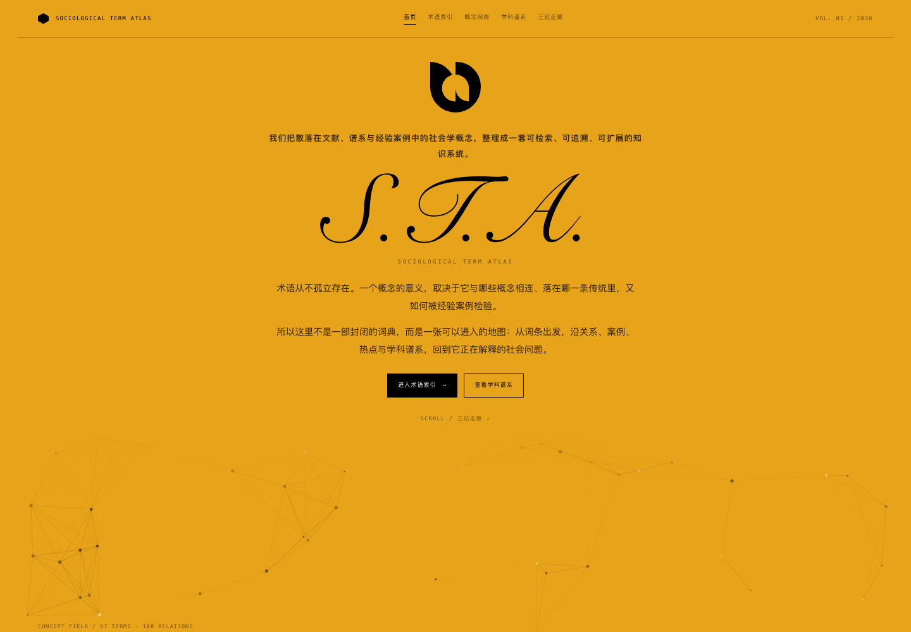
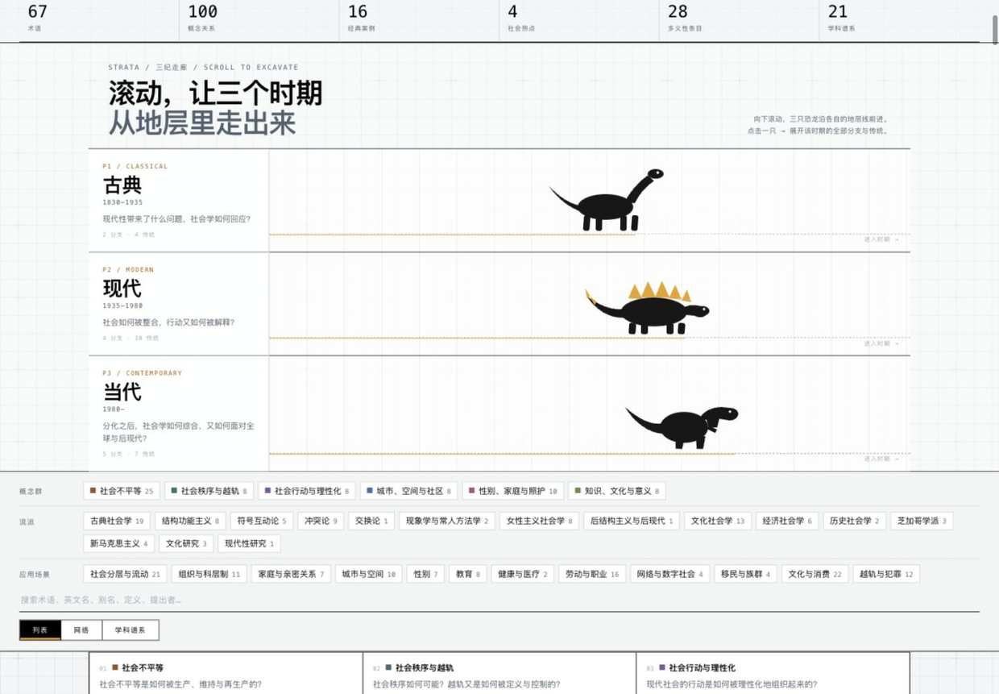
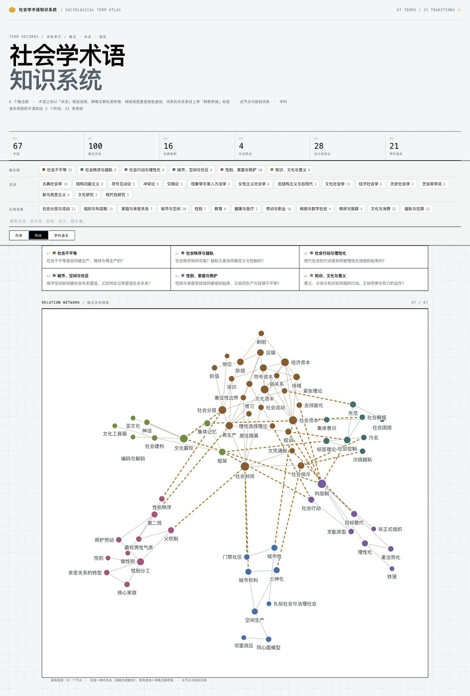
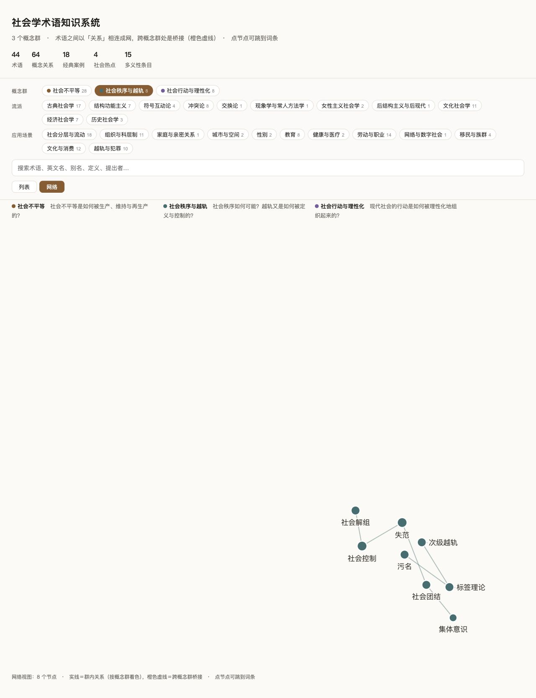
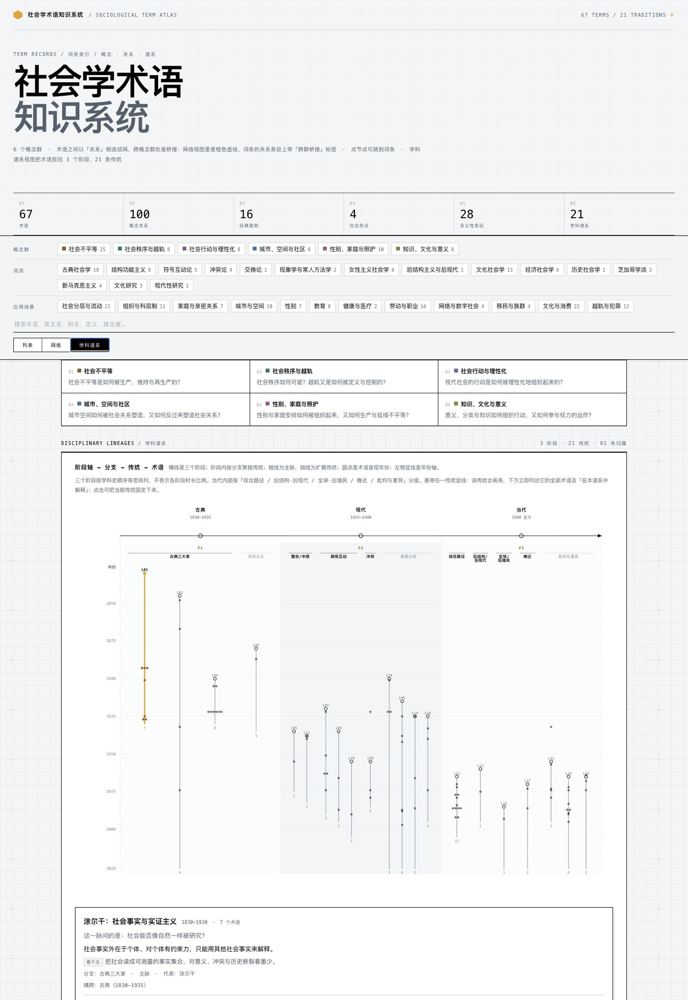
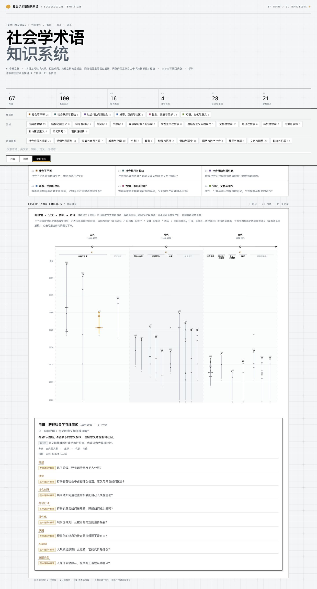
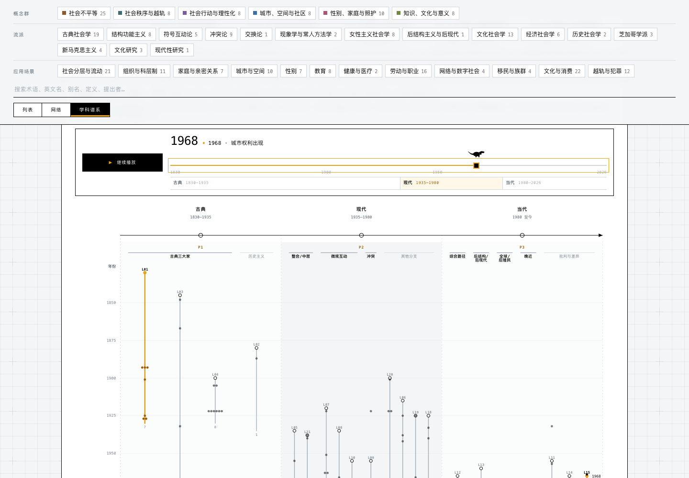

# 社会学术语知识系统

社会学概念知识库，由**六个概念群**组成、以网状结构相连：

| 概念群 | 核心问题 | 术语 |
| --- | --- | --- |
| 社会不平等 | 社会不平等是如何被生产、维持与再生产的？ | 26 |
| 社会秩序与越轨 | 社会秩序如何可能？越轨又是如何被定义与控制的？ | 8 |
| 社会行动与理性化 | 现代社会的行动是如何被理性化地组织起来的？ | 8 |
| 城市、空间与社区 | 城市空间如何被社会关系塑造，又如何反过来塑造社会关系？ | 8 |
| 性别、家庭与照护 | 性别与家庭安排如何被组织起来，又如何生产与延续不平等？ | 10 |
| 知识、文化与意义 | 意义、分类与知识如何组织行动，又如何参与权力的运作？ | 8 |

这不是一份术语词典，而是一条完整的数据生产链路：**标注规范 → 结构化数据 → 自动校验 → 负例自检 → 标注者一致性检验 → 可检索的界面（列表 + 网络 + 学科谱系三种视图）**。当前 67 条术语、100 条概念关系（含 23 条跨群桥接）、16 条经典案例、4 条社会热点；另有 3 个阶段、21 条学科谱系与 81 条术语归属，把每个术语放回学科史中的位置。

## 为什么值得做

社会学训练给我的是一堆散在书里的概念：阶级和阶层到底是不是一回事？「社会资本」在布迪厄、科尔曼、帕特南笔下指的是三种不同的东西。这些分歧在论文里靠脚注处理，一旦要变成**数据**就必须显式建模——谁的定义、哪一版、和谁冲突、依据在哪一页。

这个项目就是把这些隐性判断逼成显式字段的过程。它同时是一次自我检验：能不能把人文社科的模糊材料，做成可校验、可追溯、可被他人复用的数据资产。

## 快速开始

```bash
python3 validate.py                  # 校验数据；0 错误才算通过
python3 selftest.py                  # 负例自检：76 个注入点是否全部命中
python3 agreement.py --codebook demo/codebook.yaml annotations/*.yaml
python3 build_site.py                # 生成 site/ 下四个自包含页面（首页 / 术语 / 网络 / 谱系）
```

无第三方依赖，只需 Python 3 与 `pyyaml`。

## 界面

站点拆成四个可以互相点击进入的页面：`index.html` 首页、`terms.html` 术语索引、`network.html` 概念网络、`lineages.html` 学科谱系。每页仍是一份自包含 HTML，双击可开，不依赖服务器，也不加载任何外部脚本或视频。

视觉上参照 Amber 的工业档案风格：26px 网格底与十字定位点、等宽大写标签、黑白灰主色、琥珀色强调、方角组件和编号化信息层级。只借用视觉语言，不引入 React、GSAP 或 3D 依赖。

首页是一层影院式入场页：整屏琥珀色、80px 标记、居中标语、手写体 `S.T.A.` 签名和两段说明文字。首屏只给两个明确入口（术语索引 / 学科谱系），向下则是四张页面索引卡与「三纪走廊」。参考稿底部的远程视频被换成一块会持续呼吸的 Canvas 概念场，底部用同色渐隐接入下一段内容——保住入场感，同时维持离线自包含。

三个内容页各有独立的双栏页头：左侧是页面标题，右侧是该页要回答的问题与页面级规模指标；正文分别直接进入列表、网络图或谱系图。顶部导航与页内「列表 / 网络 / 学科谱系」标签都是真实链接，浏览器前进后退、深链接与中键新开标签页都能正常工作。

| 首页 | 术语索引 |
| --- | --- |
|  |  |
| **概念网络** | **学科谱系** |
|  |  |

**首页的「三纪走廊」把学科史做成了可滚动的入口。** 古典、现代、当代各有一只恐龙（蜥脚类、剑龙、兽脚类），随页面滚动沿各自的地层线前进；点击任一只，展开该时期的档案：按谱系图同一套分支顺序列出全部传统，每条传统可继续展开主张、盲点与术语。术语可跳回词条，传统可跳到谱系图中的对应位置。




三个内容页各自主持一套视图：**列表**按首现年份排序；**网络**把术语按关系连成图——群内连线用该群的颜色，跨概念群的关系画成橙色虚线；**学科谱系**先把学科史划成古典、现代、当代 3 个阶段，再细化为 21 条横跨阶段传统。概念群、流派、应用场景三种筛选在三个页面中都可叠加使用。



只勾一个概念群，图上就只剩这个群自己的节点与群内连线，可以看清一个群内部的结构。



点「冲突论」得到 9 条（阶级、社会封闭、文凭通胀、剥削、居住隔离……）；搜索「布迪厄」得到他名下的 9 个概念。点网络图上的节点会跳到术语页并定位、高亮对应词条。每条术语可展开多义性、学科谱系、概念关系、经典案例、社会热点五类折叠区——**数量为 0 的整栏不渲染**。

**关系分三层显示**，因为它们本来就是三种东西：`证据` 是文献里的原句（可核对），`编者解读` 说清这条边接在哪一点上，`边界` 挡住最容易过度推论的方向。没有这一层，读者只能看到一个「机制」标签，剩下全靠自己猜。


**学科谱系回答的是「这个词在学科史里站在哪」。** 它分两步：先划出 3 个阶段——古典（马克思、涂尔干、韦伯）、现代（帕森斯结构功能论、默顿中层理论、符号互动论、交换理论、冲突理论）、当代（1980s 以后）；当代内部再按「综合路径 / 后结构·后现代 / 全球·后殖民 / 晚近」分支，并保留女性主义、文化研究、新马克思主义与空间作为「批判与差异」的扩展分支。三个阶段下共细化为 21 条横跨阶段的传统，最后把 67 个术语逐条挂到传统上，写明「它在这条传统里解释什么社会学问题」。因此点开「阶级」，看到的不是「阶级属于古典社会学」这种标签，而是它同时落在马克思主义批判、冲突理论等脉络里，以及每条脉络各自追问的问题。



**谱系图是三层轴，不是「时期 × 流派」网格。** 横轴是三个先后阶段；每个阶段内先按分支聚拢，再挂若干条传统竖轴；术语以圆点落在所属传统轴上，圆点的纵向位置就是它的首现年份；左侧竖轴是年份。同一分支的多条传统沿横轴错开，一条传统也可以向下跨过多个阶段对应的年份；粗线表示主脉，细线表示扩展传统。悬停任一传统竖轴，该传统会高亮，浮层列出它包含的术语，下方同步展开这一脉的 `question`（它问什么）、`thesis`（主张什么）、`blind_spot`（看不见什么），以及每个术语在该脉络中解释的问题。



**谱系时间轴可以播放。** 点击「播放时间轴」后，琥珀色年份游标从 1830 扫到 2026；年份下方固定标好古典 / 现代 / 当代，播放时不再轮换阶段文字。术语圆点按首现年份逐个出现，遇到新术语会自动停留约 0.7–0.9 秒，同年出现的传统竖线同步亮起。播放条右侧显示最近一次出现的术语及其首现年份，并保留到下一批术语出现，避免一闪而过；轨道上另有一只小恐龙随年份从左跑到右。可以随时暂停、拖动年份或从头重播；桌面端向下滚动时，播放条吸附在筛选条下方，方便边看图谱边控制时间。




词条里的「学科谱系」只列这个词实际所属的传统；每条先标阶段与起止年份，再写「这一脉问的是」与「在本谱系中解释」。同一术语在不同作者处的定义分歧由上面的「多义性」承担，不再另建历代定义链。

**案例与热点共用同一套「相符之处 / 不符之处」写法**（v10 统一）：`match` 必须指名现象对上了定义的**哪一个要件**，`mismatch` 则按定级分两类——定「明确实例」的写语境与外推限定，定「部分符合」的必须点名缺的是哪个要件。只写相符，归属会越挂越宽；只写不符，条目会失去用途。热点另加一段解析，负责把一件事拆成几层，逐层说明哪层对上了哪个概念、哪层只是被公共讨论混在了一起。


**动效分成两层，而且都不引库。** 页面层：同源页面切换走 240ms 的 View Transitions；首页的标记、标语、签名、正文与按钮按 80ms 节拍依次上浮，整屏底色承接参考稿的影院式入场。页面内：桥接边的虚线自己流动（在说「这条边跨群」）；悬停节点时只留它和邻居、其余压暗（67 个节点谁也看不清谁）；折叠区展开时高度补间 200ms、收起 170ms；展开后各行按阅读顺序每 38ms 上浮一条、最多叠 5 层（把「证据 → 编者解读 → 边界」的次序变成看得见的节奏）；筛选时卡片从旧位置滑到新位置（FLIP，220ms）——筛选是高频操作，卡片直接跳到新位置，人会丢掉「我本来在看哪一条」；谱系页的年份游标基础推进 22 秒，遇到新术语自动停留，实际约 50 秒走完 1830–2026，术语点按年份显隐，相关传统在术语出现时短暂亮起，小恐龙沿轨道同步前进。页面内动效统一 150–350ms 与 `cubic-bezier(.2,.7,.2,1)`，全部服从 `prefers-reduced-motion`——单文件自包含这个承诺，不靠引一个动画库来破。

设计上刻意留了两处「不动」：搜索是逐键触发，每敲一个字都补间会显得抖，所以只有 chip 切换才补间；列表↔网络现在是一次真实页面跳转，只做交叉淡入，不做节点与卡片的形状形变——两种形状互相形变的成本远高于收益。


**「跨群桥接」是算出来的，不是写进去的。** 一条关系是否跨越概念群，由两端术语的 `cluster` 推出：网络视图里它画成橙色虚线，词条内的关系条目上挂一个橙色虚线标签。数据里不存这个标签——存了不但重复，术语迁移概念群之后还会变成一句错的断言。


分析范畴（如「阶层」）带独立徽章，且不渲染案例栏——它是划分现象的维度，本就不该有案例，显示一个「经典案例（0）」会让人误以为缺数据。


**空栏一律不渲染。** 多义性、概念关系、经典案例、社会热点四栏，数量为 0 时整栏不出现。三个新群目前都还没挂案例与热点，展开它们的词条时看不到那两个折叠区——「（0）」读起来像数据缺失，「不显示」读起来才是「这个条目本来就没有这一栏」。


上图是城市群的 **门禁社区**：2 条关系、尚无案例与热点，于是整张卡片只剩 `概念关系` 一个折叠区。**案例栏单独列出的原因**是它与另外三栏不同——它不是「还没填」，而是「按规范不该有」。

## 目录结构

| 路径 | 内容 |
| --- | --- |
| `schema.yaml` | **规范即配置**：封闭枚举、必填字段、字段白名单、数量约束 |
| `data/terms.yaml` | 概念层·节点：67 条术语，含多义性条目 |
| `data/relations.yaml` | 概念层·边：100 条关系（77 群内 + 23 桥接），8 种关系类型 |
| `data/lineages.yaml` | **学科谱系层**：3 个阶段、21 条传统、81 条术语归属 |
| `data/cases.yaml` | 实例层：16 条经典案例，带归属块 |
| `data/hotspots.yaml` | 实例层：4 条社会热点，带复审期 |
| `validate.py` | 校验器，按 `schema.yaml` 逐条比对 |
| `negative/` | **负例集**：故意写错的数据 + 期望命中清单 |
| `selftest.py` | 负例自检：断言校验器抓得住每一条规范 |
| `agreement.py` | 标注者间一致性：完全一致率、Jaccard、Krippendorff's α |
| `annotations/` `demo/` | 双人复标样本与编码本 |
| `build_site.py` → `site/` | 四页静态站生成器（首页 / 术语 / 网络 / 谱系） |
| `数据结构.md` | 字段定义与生命周期 |
| `标注规范细则.md` | 判定规则、反模式、变更记录 |
| `项目范围.md` | 概念群边界、学科谱系边界与规模目标（v8） |
| `新增术语指南.md` | 扩充术语的操作步骤、可复制模板、避坑清单 |

## 六条设计原则

1. **概念层稳定，实例层流动。** 术语与关系长期有效；案例与热点持续流入，热点过期只降级、不影响概念层。
2. **每条结论必须可追溯。** 定义、关系、归属都要能指回具体文献或链接，没有出处的不入库。
3. **归属必须有反面。** 把一个现象归入某个概念时，必须同时写出它**不符合**该概念的哪些部分。`mismatch` 字段为空会被校验器直接拦下——这是防牵强附会的核心机制。
4. **枚举值封闭。** 流派、应用场景等字段只能取预设值。允许自由填写会让标签体系在几十条之后彻底失效。
5. **同一事实只存一处。** 能由其它字段推出的，一律不存：一条关系是否跨概念群，由两端术语的 `cluster` 推出；学科谱系的归属不存 `period`，由谱系的 `periods` 推出。冗余字段不只是多写一遍——它会**过期**，而校验只看源字段，过期的那份不会有人发现。
6. **群内可以密，群间必须克制。** 每个术语归属一个概念群，跨群桥接每对群上限 5 条、且禁止标注「等同」。早期版本干脆禁止跨群关系，后来发现那样会丢掉「不平等」与「越轨」之间真实存在的联系，于是改为受限放行——代价是要多写一条校验规则。

## 数据规模

| 层级 | 数量 | 说明 |
| --- | --- | --- |
| 概念群 | 6 个 | 每群一个核心问题；术语只能归属一个群 |
| 术语 | 67 条 | 覆盖全部 15 个流派、12 个应用场景 |
| 概念关系 | 100 条 | 8 种关系类型（当前用到 7 种，`等同` 群内可用、群间禁用）；每术语上限 12 条，防过度连接 |
| 群内关系 | 77 条 | 群的骨架，允许密集成网 |
| 跨群桥接 | 23 条 | 15 对群中有 8 对已连；每对群上限 5 条 |
| 经典案例 | 16 条 | 每处归属都写了不符之处 |
| 社会热点 | 4 条 | 限定 3–5 个：热点是入口不是主体 |
| 多义性条目 | 28 条 | 同一术语在不同作者笔下的定义分歧（共 31 处） |
| 学科谱系 | 21 条 | 横跨 3 个阶段的传统；每条都写问题、主张与盲点 |
| 学科谱系归属 | 81 条 | 67 个术语全部入谱；14 个术语同时属于两条以上传统 |
| 关系解释 | 100 条 | 每条关系都写了「这条边在说什么」（`explain`） |
| 关系边界 | 93 条 | 「这条边不意味着什么」（`boundary`），对立/借用/转化类优先写 |
| 热点解析 | 4 条 | 每条热点按「分层 → 逐层定符合度 → 点出混淆处」写成一段 |
| 负例注入点 | 76 个 | 每条规范都有一个对应的已知坏样本 |

### 跨群桥接矩阵

15 对概念群的两两组合，每格是桥接条数（上限 5）。

| | 不平等 | 越轨 | 理性化 | 城市 | 性别 | 知识 |
| --- | --- | --- | --- | --- | --- | --- |
| 社会不平等 | — | 5 | 5 | 4 | 3 | 1 |
| 社会秩序与越轨 | 5 | — | 1 | 0 | 0 | 2 |
| 社会行动与理性化 | 5 | 1 | — | 0 | 0 | 2 |
| 城市、空间与社区 | 4 | 0 | 0 | — | 0 | 0 |
| 性别、家庭与照护 | 3 | 0 | 0 | 0 | — | 0 |
| 知识、文化与意义 | 1 | 2 | 2 | 0 | 0 | — |

名额用了 23/75。**空格不是遗漏，是判断。** 早期版本的规则是直接禁止跨群关系，后来发现那样会把真实存在的联系一起砍掉，于是改成「受限放行」：桥接要逐条论证、每对群封顶 5 条、跨群禁标「等同」。剩下 7 对之所以是 0，是因为还没找到可引用的原句来说明它们在哪个问题上交汇——**宁可留空，也不硬连**（v5 之前这个位置还挂着一处 0 关系的例子：术语「内卷化」连群内关系都没连，后来随范围调整删除；「刻意不成边」现在只体现在这 7 对空格上）。

## 这套结构与数据运营工作的对应

| 本系统 | 对应 VLM / 多模态数据工作 |
| --- | --- |
| 术语多义性条目 | 同一图像在不同标注规范下的多重归属 |
| 归属块（一个热点挂多个术语） | 多标签标注 |
| `mismatch` 必填 | 边缘样本必须记录不符合项 |
| `match` 与 `mismatch` 成对必填 | 标注必须同时记录「对上什么」与「没对上什么」，防止只挑合用的部分 |
| `evidence`（引文层）与 `explain`（解读层）分栏 | 数据里区分「原始证据」与「标注者解读」，解读不得当作证据使用 |
| `confidence` 三档 | 标注确信度分级，容忍不确定性 |
| 双人独立复标 + 算一致率 | 标注者间信度检验 |
| 封闭枚举 + 字段白名单 | 标签体系封闭，防止自由填写导致体系失效 |
| 规范即配置、可回溯重判 | 标注规范迭代与历史数据回溯 |
| `negative/` + `selftest.py` | 用已知坏样本验收质检脚本 |
| 概念群 + 跨群桥接上限 | 数据分域与跨域样本配额，防止单一来源或单一场景压垮数据集 |
| 热点复审、过期降级 | 数据生命周期管理 |

## 开发中真实踩过的坑

**1. 一个逗号悄悄吃掉了一半的出处。**
`relations.yaml` 用行内映射写法，`source: Lin 2001, Social Capital` 里的英文逗号被 YAML 当成字段分隔符——`source` 只剩 `Lin 2001`，后半段变成一个假字段。6 条关系的出处被静默截断，而校验**全部通过**。修复后加了 `schema.fields` 字段白名单，多余字段一律判错。讽刺的是，后来写负例期望清单时我又踩了同一个坑（`where: TERM-9005.polysemy[1]` 里的方括号）。

**2. 单阈值查重会产生误报。**
在同一套方法做图像质检时发现：单一 dhash 阈值会把「打伞的人 / 斑马 / 飞鸟」三张无关图判成重复。改成两段式——pHash 先做候选择，再用灰度余弦验证。

**3. 加一个概念群要改两处，漏改一处会伪装成数据错误。**
概念群同时登记在 `schema.yaml` 的 `clusters`（写核心问题）和 `enums.cluster`（放开取值）里。只改前者不报「配置有问题」，而是让该群的每一条术语都报「枚举非法」——报错指向数据，根因却在配置。第六个群上线时加了 `check_schema()` 专门拦这一条，并配了负例（N57）：报错文案直接说清该改哪一行。

**4. 一致性系数不能只报一个数。**
Krippendorff's α 在多标签数据上随编码本口径显著变动：只计入被提及的术语，α 假性偏低（实测出现过 0.667 的完全一致率对应 α = −0.088）；计入完整编码本又会因大量「双方都未标注」的空单元而偏高。因此本项目**只报区间**（当前 0.815～0.853；区间随编码本口径移动，术语删除后会重测），并与完全一致率、平均 Jaccard 对照解读。

## 已知限制

- **出处只登记到「作者 + 书目」，不要求页码**（v11 推翻旧做法）：读者无法自己翻到原句复核，只能信任标注者——这是为了让出处字段真正被填上而接受的代价，详见 `标注规范细则.md` 铁律 2。
- 4 条热点填写的是来源名称与日期，未附可核验链接（该字段已改为选填）；`HOT-0001` 已过复审期，待降级或延期。
- 多义性条目的 `school` 字段在作者流派归属存在争议时留空，与早期条目写法不一致。
- 16 条经典案例的 33 处归属已按 v10 重写（`match` 指名要件、`mismatch` 按定级分写），但**这 16 条案例全部挂在「社会不平等」群**：案例是 v1 建的，当时只有这一个群，此后加群时优先补的是概念层与关系层，另外 5 个群的实例层至今是空的。重写只统一了写法，没有解决覆盖——那是下一步的事。
- `explain` 与 `boundary` 是编者解读，不是引文；`evidence` 才是引文层，但出处已不含页码，两者都只能靠复核人重读判断。
- 术语分布偏重（古典社会学 19 条、文化社会学 13 条；文化与消费 22 条、社会分层与流动 21 条），健康与医疗仅 2 条、后结构主义与后现代 / 交换论 / 现代性研究各 1 条。
- **三个新群（城市、性别、知识）的案例与热点都是 0。** 概念层与关系层已经立住，实例层还没开始填——这也是「空栏不渲染」这条界面规则最先派上用场的地方。
- **桥接只覆盖 15 对群中的 8 对。** 其中「城市、空间与社区」与另外三个新群之间全是 0：城市空间与性别秩序、文化意义显然有关系（门禁社区里的家庭策略、士绅化中的文化区隔），但还没找到可引用的原句，宁可留空也不硬连。
- 「社会秩序与越轨」与「社会行动与理性化」之间只有 1 条——科层制的规则执行与越轨的界定明显有联系，仅补上一条机制关系后仍显单薄。
- **21 条学科谱系是骨架，不是穷尽。** 主脉覆盖古典三大家、帕森斯与默顿、符号互动论、交换理论与冲突理论；当代覆盖综合路径、后结构/后现代、全球/后殖民与晚近，并保留女性主义、文化研究、新马克思主义与空间作为扩展分支。**中国社会学、数字/平台研究、情感与身体社会学仍未建立独立传统**——不是因为不重要，而是当前 67 个术语里没有能撑住这些脉络的条目；宁可留空，也不为了「看起来完整」硬造归属。全球/后殖民分支虽有沃勒斯坦与南方理论的位置，但独立术语条目仍然偏少。
- **81 条学科谱系归属全部是 `草稿`**：`problem` 是编者对「它在该谱系中解释什么问题」的判断，尚未逐条复核。`ongoing: true` 的谱系把 `to` 记为编目年份 2026，界面显示为「至今」，不代表该传统在 2026 年终止。
- **学科谱系与 `school` 不互相推导。** 现有 15 个「流派」混了时期（古典社会学）、范式（结构功能主义）与领域（文化社会学/经济社会学）三种东西，不能拿它自动生成大谱系；大谱系独立成层，`school` 只作检索标签。
- 全部 67 条术语的 `status` 仍是 `草稿`：v11 之前它们挂的是「待核页码」，现在出处已写全作者与书目，但还没有人逐条复核过——`草稿` 现在表示「出处已填、尚未复核」，不再代表出处缺失。

## 规范变更

`标注规范细则.md` 记录每次判定规则的变更与影响范围，当前 v15（数据规范 `schema.yaml` 为 v13，两者版本号不同步：细则记的是判定规则，schema 记的是字段与约束）。数值化的规则全部落在 `schema.yaml`，改规范只需改这一个文件，历史条目按新版规范回溯重判。

**v11 推翻了一条自己定的规矩。** 铁律 2 原来要求「出处的页码必须核过」，执行结果是整库挂着 `【页码待核】`：一条都没核，而每个字段看起来都像已登记。删掉页码要求之后，出处留下来的是「作者 + 书目」，是能唯一指认的实内容。**这条推翻的代价必须记着**——没有页码，读者无法自己翻到原句，只能信任标注者；接受这个代价，是因为「有具体出处」比「有精确页码但一条都没核」更有用。
